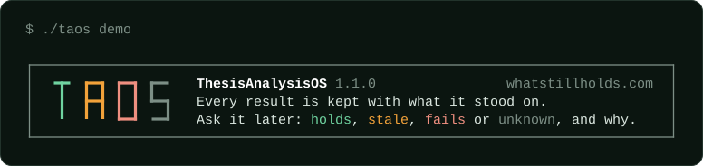
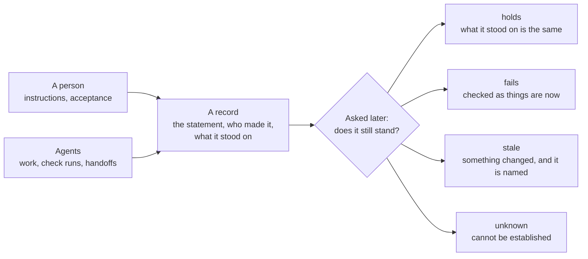
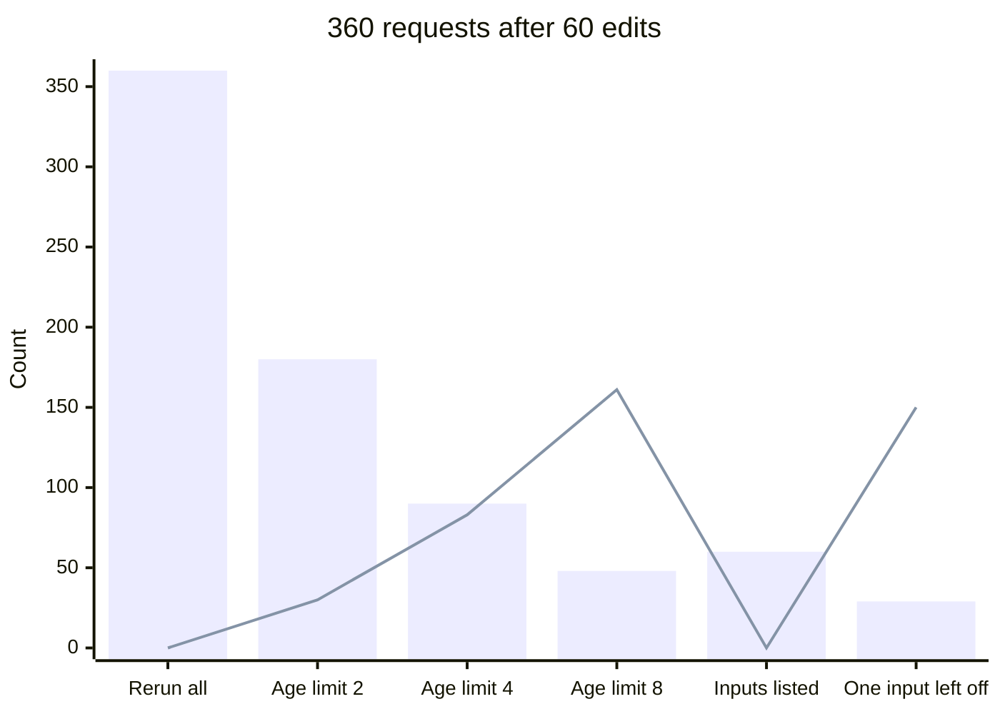

# ThesisAnalysisOS

<h2 align="center">
  Your AI agent said “finished” 19 times.<br>
  On day 1, one setting changed.<br>
  How many of the 19 can you still trust?
</h2>

<p align="center"><i>Pick an answer before you scroll.</i></p>

<div align="center">

<details>
<summary><b>All 19.</b> Each one passed its check.</summary>
<br>

That is what the record said too. All 19 still read `finished ✓`.

But a result is only as good as what it stood on, and one of those things
changed on day 1. Nothing recorded which of the 19 used it. So the honest
answer is the one nobody on the team could give: **you cannot tell.**

</details>

<details>
<summary><b>About half.</b> Only the ones that used the setting.</summary>
<br>

The right instinct. Only the results that used the setting are in doubt.

So which ones used it? Nothing recorded that. The honest answer is
**you cannot tell**, which puts all 19 in doubt.

</details>

<details>
<summary><b>None.</b> Check everything again.</summary>
<br>

The safe answer, and the slow one. Nothing says where to start.

The honest answer is **you cannot tell** which of the 19 used the setting.
That is the whole problem.

</details>

</div>

<p align="center">
  This happened on a real research project. A colleague noticed on day 20.<br>
  <b>ThesisAnalysisOS says it on day 1, in one word.</b>
</p>

<p align="center">
  <a href="https://whatstillholds.com/">
    <picture>
      <source media="(prefers-color-scheme: dark)" srcset="docs/story-dark.svg">
      
    </picture>
  </a>
</p>

<p align="center">
  <a href="https://whatstillholds.com/"><kbd>&nbsp;Play it in the browser&nbsp;</kbd></a>&nbsp;
  <a href="#see-it-in-a-minute"><kbd>&nbsp;Run the demo&nbsp;</kbd></a>&nbsp;
  <a href="https://github.com/JustinBen0131/ThesisAnalysisOS/generate"><kbd>&nbsp;Use this template&nbsp;</kbd></a>&nbsp;
  <a href="https://github.com/JustinBen0131/ThesisAnalysisOS/archive/refs/heads/main.zip"><kbd>&nbsp;Download ZIP&nbsp;</kbd></a>
</p>

ThesisAnalysisOS (TAOS) is for a person or a team working with AI agents. It keeps
the result of each check with the files the check says it reads. After an edit
it compares those files with the fingerprints it saved, and says which earlier
results hold, which are stale, and why.

| It answers | In one word | Where it runs |
|---|---|---|
| Which results can still be used? | `holds` · `stale` · `fails` · `unknown` | On your computer, with the Python standard library. No model call, no network, no account. |

**An answer costs no tokens.** It is worked out by comparing files on your own
disk. An agent pays only to read it.

## Try the decision here

This page is playable. Open one choice at a time.

> You are the next AI agent on a research project. The team has been at it for
> 19 days. Every piece of work in front of you says finished. The team wants its
> next result today, and it will stand on all 19. **Do you build on it?**

<details>
<summary><b>Build on it.</b> Every piece says finished.</summary>
<br>

Your result becomes the twentieth piece.

On day 20 a colleague notices that later results have shifted, and traces it
back to one setting. Your result stands on it too. Open <b>What had changed?</b>

</details>

<details>
<summary><b>Check all 19 first.</b> Nothing says where to look.</summary>
<br>

You stop to check. Nothing in the record tells you where to look first.

On day 20 a colleague notices that later results have shifted, and traces it
back to one setting. Open <b>What had changed?</b>

</details>

<details>
<summary><b>What had changed?</b> Back to day 1.</summary>
<br>

**The number was perfect. That was the problem.**

A team was testing a computer simulation of its detector. They sent in a known
signal of 1,000 units, but the simulation read 970.

An AI agent switched off one correction. Now the simulation read exactly 1,000.
That looked like an improvement.

| | Reading |
|---|---|
| Signal sent in | 1,000 |
| Simulation reads | 970 → 1,000 |
| Real detector reads | 970 |

But the team had already measured the real detector using the same signal. It
read 970 too.

The simulation was supposed to reproduce the real detector, not an ideal one. By
making the simulation read a perfect 1,000, the agent had actually made it less
faithful to the experiment.

That earlier measurement was already recorded. But nothing connected it to the
changed setting, so the apparent improvement went unchallenged.

</details>

<details>
<summary><b>The same day, with ThesisAnalysisOS in place.</b> What the next agent is handed.</summary>
<br>

| | As it happened | With ThesisAnalysisOS |
|---|---|---|
| The earlier check says | `finished ✓` | `stale`, needs rechecking |
| What changed | No warning connected the changed setting to the earlier check. | One setting in the detector simulation. This check used the old setting. |
| Where to resume | | At that setting. Then run the check again. |
| Still a scientific decision | | Which setting is right. A new pass will not say. The team’s reference is there to compare. |

What the record answers after the setting file changes, from a recorded run on
a small stand-in project:

```text
$ taos why INS-1
  stale    check response: model changed: model/settings.json
  INS-1 does not stand as recorded: stale.
```

> [!IMPORTANT]
> A pass does not say which setting is right. The next agent gets what changed,
> what needs rechecking, and where to resume. The scientific decision stays with
> the team.

The sequence comes from dated project notes, with identifying details removed.
The visitor’s choices and the signal of 1,000 units illustrate the decision.
Check the recorded run with `python3 evals/replay_setting_change.py --verify`, or
[play the full version](https://whatstillholds.com/#try).

</details>

## Who it is for

One person can coordinate multiple AI agents on the same project. Give a
planner, a builder and a reviewer distinct names, even when they use the same
tool. Local sessions can read the project directly. A ChatGPT conversation
or another web assistant can review a handoff you choose to share.
[Configure agent roles](docs/AGENT_ROLES.md) · [Connect your tools](docs/AGENT_INTERFACES.md)

Teams share these files in a workspace they trust. An approval carries the
reviewer label supplied to the command. For an independently attributable
sign-off, keep an access-controlled review record. [Trust and access](SECURITY.md#working-with-a-shared-research-record)

> [!NOTE]
> This independent research prototype grew out of the software used to coordinate
> AI agents during a physics thesis. It is not affiliated with any employer or product.

## See it in a minute

[](docs/opener.svg)

Use Python 3.9 or later. Cloning the repository requires Git.

```bash
git clone https://github.com/JustinBen0131/ThesisAnalysisOS.git
cd ThesisAnalysisOS
./taos demo
```

The demo builds a temporary project, fits the acceleration due to gravity
(`g`) from six pendulum swings, and asks the record about that result as the
files and instructions around it change. This is everything it prints.

```text
┌──────────────────────────────────────────────────────────────────────────────┐
│  ╺┳╸ ┏━┓ ┏━┓ ┏━╸   ThesisAnalysisOS 1.1.0                whatstillholds.com  │
│   ┃  ┣━┫ ┃ ┃ ┗━┓   Every result is kept with what it stood on.               │
│   ╹  ╹ ╹ ┗━┛ ╺━┛   Ask it later: holds, stale, fails or unknown, and why.    │
└──────────────────────────────────────────────────────────────────────────────┘
Here: six pendulum swings, a fit for g, and a check that g is 9.6 to 10.0.

1  A result holds until what it stood on changes
   holds   the fit passes its check and the task closes: g = 9.82 +/- 0.02
   holds   the plot style is edited, which the check never read
   stale   one swing is measured again: data/swings.csv changed

2  A pass belongs to the files, not to the task
   holds   the check runs again on the new swing: g = 9.75 +/- 0.02
   holds   a second task asks the same check of the same files: not run twice

3  An instruction keeps its date
           February 10: "Use the tape-measured lengths" is in force
           March 2: "Use the laser-measured lengths" is in force
   stale   the task closed with neither on record, and its closure says so

4  Acceptance is of one version
           a person reads the fit and accepts the result
   stale   the code is edited afterwards: the acceptance was of the old version

5  A reminder shown is not a mistake repeated
           a new agent starts and is told the lesson in the person's own words
           asked later: 0 repeated, 0 followed, 1 not judged, of 1 times shown

6  A check passes only on what it declared
   fails   a check reads figures/style.txt but declared only the analysis
   holds   the declaration is corrected and the same check passes

18 commands ran in 0.5 s, and the record gave all 26 answers expected of it.
Each row is a real command and its answer. See them all: ./taos demo --full
Nothing of yours was touched. `./taos demo --keep` leaves the folder in place.
```

`./taos demo --full` shows each command and what it printed, and
`./taos demo --json` gives the same run to a program. Every command in the
script carries the words the record should answer with. If the record answers
differently, the demo stops and says so.

The check in the demo passes when there are at least five swings, `g` is
between 9.6 and 10.0 m/s² and its uncertainty is at most 0.2
([`check.py`](examples/measurement/analysis/check.py)).

**Then do it by hand.** `./taos demo --keep` leaves the project in place and
ends with six lines to paste: go to the folder, read the checks, add a swing
of your own, and ask again what holds. In that project `../os/taos status`
opens with the same four answers. Asked nothing, `./taos` says where to
start. Every screen follows [six short rules](docs/INTERFACE.md).

## The idea



The failures this system was built to stop have one shape: a record was
consulted without the conditions it was true under. A check passed, and the
files were edited afterwards. An instruction was given, and later replaced.
A reminder was shown, and the count of times shown was read as a count of
mistakes. Each record was true. Each was true of something that had changed.

So TAOS stores a statement together with who made it and what it stood on,
and answers one question about it later:

| Answer | Meaning |
|---|---|
| `holds` | the inputs recorded for this check still match |
| `fails` | it was checked on things as they are now, and did not pass |
| `stale` | something it stood on changed, and the answer names it |
| `unknown` | it cannot be established: never checked, not recorded, or a change nobody declared the effect of |

`unknown` is an answer. It is never rounded to true, to false or to zero.

Three rules follow. None of them depends on which models are in use.

1. **Reuse follows the recorded inputs.** An old check can still apply if its
   inputs and check definition match. List every input the calculation reads.
   An empty undeclared workspace yields `unknown`.
2. **The original words outrank any summary of them.** An instruction is kept
   as it was said, with its date, scope and expiry, and is delivered in those
   words. A summary carries the hash of its original and goes stale with it.
3. **An observation has a kind and a source.** Shown is not violated.
   Recommended is not executed. Missing is not false. A check passing is not
   a person accepting the result.

**Why this matters more as agents do more.** A project run by agents piles up
earlier results faster than anyone can recheck them. Rerunning everything
does not scale, and trusting by age is wrong in both directions at once: in
the experiment below, every age limit either reran work that nothing had
touched or relied on work that something had. A result kept with its basis
was rerun exactly when an edit reached it, and was never relied on wrongly.

The idea is old, and `docs/METHOD.md` says where it comes from: build systems
and truth maintenance systems have kept results with their justifications for
decades. What is added here are the things research rests on that a build
system does not model: dated human instructions, and a person's acceptance of
one exact version.

## Three studies, each one command

Each is a small controlled example with its saved run in `evals/results/`.
The first line says what was found. The account folds open under it.

### Audit a measurement

**With all inputs declared, all 27 edits that changed the fit made its earlier pass `stale`. Fresh checks passed in 21 cases and failed in six.** A stale pass says the old
result no longer speaks for these files. Only the new run says whether the fit
still meets its limits.

[The experiment and its limits](docs/MEASUREMENT_AUDIT.md) · [Case-level observations](evals/results/measurement_audit.json). Reproduce with `python3 evals/measurement_audit.py --verify`.

<details>
<summary>The experiment in full</summary>

A fit to six pendulum swings estimated the acceleration due to gravity. We
changed one period or the calibration and inspected the saved pass (called a
*receipt*) before we ran the fit again. We compared the new fit and its
standard error with a separate calculation. An earlier pass can become stale
even when the updated fit still meets the acceptance limits.

With all inputs listed, the earlier pass became stale for all 27 edits that
changed the fitted result in 32 cases. Three more edits changed the input
files while preserving the fitted numbers. In four additional controls we
changed how the software classified the data. When no group included the
data, both edits returned `unknown`. When the fit left an existing data
group off its input list, it kept the old pass on both edits, although both
fresh checks failed. The two implementations agreed on both the estimate and its standard error within
1e−10 m/s² across all 36 cases.
The frequencies describe selected edits to one teaching dataset.

Read the [experiment and its limits](docs/MEASUREMENT_AUDIT.md) or inspect the [case-level observations](evals/results/measurement_audit.json). Reproduce the checked-in readings with the first command. The second independently reconstructs the edits and uncertainties from the raw records using exact rational sums. The third accepts your own measurements.

```bash
python3 evals/measurement_audit.py --verify
python3 evals/review_measurement_audit.py
python3 evals/measurement_audit.py --input path/to/swings.csv
```

</details>

### What the next task can reuse

**A pass belongs to the exact bytes, whichever task asks.** Restoring the
earlier file brought the earlier pass back. The same reading written with
different decimals needed a new run.

[Handoff method and results](docs/HANDOFF_AUDIT.md) · [Raw observations](evals/results/handoff_audit.json). Reproduce with `python3 evals/handoff_audit.py --verify`.

<details>
<summary>The experiment in full</summary>

Three tasks asked the same pendulum fit check over one sequence of edits. The third task saw a failure on the current readings and reran the check. Restoring the exact earlier CSV recovered the original pass. Writing the same reading with different decimal spelling required a new pass.

</details>

### Can two corrections conceal a failure?

**In a pooled score, yes. The total stayed at six of eight while one
instrument fell to two of four and failed its own check.** The scores are
fictional and set by hand, so the arithmetic can be followed.

[Four controlled edits](docs/MODEL_EVALUATION.md) · [Original readings and predictions](examples/model_evaluation/) · [Saved observations](evals/results/model_evaluation.json). Run the experiment with `python3 evals/model_evaluation.py --verify` or reconstruct the counts without running the model with `python3 evals/review_model_evaluation.py --self-test`.

<details>
<summary>The experiment in full</summary>

After two fictional instrument scores were corrected, the classifier still detected six of eight known faults overall. Instrument A fell from three of four to two of four and failed its check. Instrument B rose to four of four. Both corrections changed files used by the pooled check. It ran again and gave the same answer.

</details>

## The measured trade-off

Sixty file edits, each followed by a request for all six results. Bars count
the checks that ran. The line counts stale results that were relied on.



Rerunning everything is safe and slow. Trusting by age is cheaper and wrong.
Listing what each check reads did the least work that was still right. Leaving
one input off each list is the failure to watch for.
[Method and data](https://whatstillholds.com/studies/reuse-frontier/) · `python3 evals/reuse_frontier.py`

## What is tested

The [claim register](docs/CLAIMS.md) links the software's claims to named tests
or recorded experiments. The table summarizes the public checks.

| Claim | Evidence | Run it yourself |
|---|---|---|
| Earlier releases had 22 distinct cases of a record read without its conditions; each is now refused or reported | 22 of 22 fail at `071a348`, 5 of 22 fail at `89f36ce`, 22 of 22 pass here | `python3 evals/at_revision.py` |
| The tests detect each of the 20 seeded faults in this run | 20 protections removed one at a time; 20 of 20 removals are caught | `python3 evals/mutations.py` |
| Tracking the folders each check read avoided stale reuse on this synthetic workload | 60 edits, each followed by all six checks being asked (360 results relied on): 60 executions and 0 wrong reuses, the same as an oracle; age limits gave 180 to 48 executions with 30 to 161 wrong reuses | `python3 evals/reuse_frontier.py` |
| Omitting an input folder allowed obsolete reuse in the open run and prevented the check from passing in the isolated run | 150 wrong reuses in 360 in the open; isolated, 0 of 366 runs passed (those 360 and the six first runs), so nothing was reused | same |
| Cases in the self-test suite | 328 tests. CI exercises Python 3.9 and 3.12 on Linux and macOS. | `./taos selftest` |
| This page says what the recorded runs say | every row of `docs/CLAIMS.md` and every number above, read back against the code as it is | `python3 evals/claims.py` |

**How to verify the numbers.** Each run is stored in `evals/results/`
with a fingerprint of the code it measured. `python3 evals/claims.py` asks of
every claim what TAOS asks of any result, and answers `holds`, `stale`,
`fails` or `unknown`. Edit `taos_core/gates.py` and the reuse numbers are
`stale` until they are measured again. CI fails until then.

The isolation result was a prediction first. It was committed on its own
before the code existed, so the history shows the order (`docs/METHOD.md`,
"A seventh prediction").

## What it does not do

- **In the open, it trusts what a check declares.** A check that reads a
  folder it did not declare is reused when that folder changes. Marking the
  check `"isolated": true` runs it in a fresh directory containing its declared
  files, with a fixed environment. In our missing-folder experiment the check
  then failed. On macOS the network and the rest of the workspace are closed
  to it too; elsewhere the record says they were open. Placing the files takes
  time, and a file outside the workspace can still be read by its absolute path.
- **Ignored files need a declared input group.** A *domain* is a named group
  of files. Include a Git-ignored data file in a domain and declare that
  domain as an input to the check if a change to the file should be detected.
- **It cannot see outside the workspace.** A check that depends on the
  network, the clock or the environment has to say so with `max_age_hours`.
- **Asking has a cost.** Each consultation rereads the declared inputs. In
  the 60-edit example, reuse spared five check executions per edit. The time
  those executions save depends on the checks and their inputs. The
  [claims register](docs/CLAIMS.md) reports timing separately for the machine
  and workload measured.
- **The evidence is mechanical.** These tests show the mechanism does what it
  says. They do not show that research done with it comes out better. That
  needs a study this repository does not contain.

## Check a compute campaign

Three jobs finished. One returned an empty result. See which outputs you can keep and which one needs attention.

```sh
./taos hpc review examples/hpc/campaign.json
./taos usage progress --packet examples/hpc/campaign.json
```

The fictional scheduler record accounts for 220 worker-seconds across three attempts. A and B passed their output checks. C needs review. In a configured project, add `--task TASK-ID` to the review and run `./taos usage progress --task TASK-ID` to see the recorded compute beside executed checks, reused checks and human acceptance.

GitHub runs this example in CI. Open a completed run and find **Fictional sensor campaign** on its Summary page. [View the selftest runs](https://github.com/JustinBen0131/ThesisAnalysisOS/actions/workflows/ci.yml)

For your own workstation, cluster or cloud project, start with the research question and the checks your outputs must pass. [HPC policy and agent instructions](policies/HPC.md)

## Reading this repository

| If you have | Start with |
|---|---|
| one minute | `./taos demo` |
| five minutes | this page, then `docs/CLAIMS.md` |
| twenty minutes | `taos_core/basis.py` (the comparison, about 250 lines), `tests/test_counterexamples.py`, then `docs/METHOD.md` from "One error, one answer" |
| an agent with you | `docs/ARCHITECTURE.md`, "Reading this repository cold": where each idea lives, the commands that verify it, and what to keep true when changing it |

[Find a guide by task](docs/README.md)

> [!TIP]
> **If you are an AI agent reading this:** do not set the system up first. `AGENTS.md` says so in its
> first section, and [the guide for AI agents](https://whatstillholds.com/llms.txt) leads to the same evidence.

An agent asked to examine or change TAOS should not set it up first.
`AGENTS.md` says so in its first section.

## Use it for your own work

One command, and no questions. Name the folder your work is in and a command
that passes when the work is right:

```bash
./taos use ~/my-analysis --check "python3 analysis/check.py"
```

TAOS runs the check once and keeps its result with the files it stood on.
Edit one of them, then ask:

```bash
./taos why        # what no longer holds, and the file that changed
./taos status     # where everything stands, answers first
```

The record stays in this copy, in `.taos/`, which git ignores, so nothing
about your tasks leaves your disk. In your folder it writes three small
things, and prints the one command that takes them out again: a short block
in `AGENTS.md` and in `CLAUDE.md`, so that an agent opening the folder knows
the record is there, and `.taos-link.json`, which says where this copy is.

### The full setup, with an agent

For a long project shared by more than one agent, set the whole system up:
your rules in your own words, a task list, hooks and a dashboard. Make your
own private copy from the template. This is meant to be a repo you rewrite,
not one you track.

```bash
gh repo create <you>/<your-os-repo> --private --clone --template JustinBen0131/ThesisAnalysisOS
cd <your-os-repo>
codex        # or: claude
```

On github.com the same thing is the **Use this template** button. `MANUAL.md`
has two other ways, for keeping the upstream or for working without GitHub.

Paste as the first message to the agent:

```
Read BOOTSTRAP.md in this repo and follow it exactly. Ask me the ten bootstrap questions in one message, then construct the OS from my answers. Do not touch anything outside this directory until I have answered.
```

Answer the questions. The agent validates, constructs, runs the doctor, and
starts your first task. Then, in your own terminal:

```bash
./taos panel on
```

**The split that matters:** this private repo holds the OS and your operating
state (`.taos/` is git-ignored, so your tasks never leave your disk). Your
actual work repos receive only a four-line block in `AGENTS.md`, a
`.taos-link.json`, and optionally the hook files. Nothing else crosses, so
nothing your colleagues review ever contains your agent bookkeeping. See
`policies/REPO_SPLIT.md`.

## What a day looks like

```bash
./taos status                # where everything stands, answers first
./taos why                   # what was recorded and no longer holds, and why
./taos brief --print         # what changed, what needs you, nothing else
./taos task list             # every task, hot ones first
```

Tell a project agent "work on AZ-7". It runs `taos start` and is shown what
stands, which of your instructions govern the task in your own words, and
what was learned the last time. It works, runs the checks, and finishes with
evidence or a handoff another agent can pick up. To move a task to review
or done, its checks must still hold or a waiver and its reason must be recorded.
When you have looked at the result, `./taos task accept AZ-7` records that you
accepted that version; a later edit does not inherit it.

## The parts

<details>
<summary>Every part of the repository, one line each</summary>

| Part | What it does |
|---|---|
| `taos` | the whole command line, stdlib only |
| `taos_core/basis.py` | the one place a result is compared with what it stood on |
| `taos why`, `taos_core/standing.py` | every record a task rests on, read back against the present |
| `AGENTS.md`, `CLAUDE.md` | the project instructions shared by the agents, rendered for you at setup |
| `hooks/` | the bundled host hooks check for exposed secrets, force pushes and writes to reserved lanes |
| `.taos/` | your state: tasks, claims, events, decisions, handoffs, check results |
| `kernels/` | distilled context with a fingerprint and an expiry |
| `atoms/` | corrections a machine can check, run by `taos doctor` |
| `policies/` | the rules, each under a page |
| `taos change`, `lesson`, `replay`, `bank`, `rule`, `anchor` | how you know the system is getting better (`docs/METHOD.md`) |
| `evals/` | the four evaluations above, each one command, and the runs they recorded |
| `examples/measurement/` | the small measurement the demo uses |
| `MANUAL.md` | the manual for the human |
| `docs/ARCHITECTURE.md` | the map for anyone, person or agent, reading the code |
| `docs/INTERFACE.md` | the six rules every screen follows |
| `docs/SPEC.md` | the binding spec for anyone changing the OS |

</details>

## The science layer

<details>
<summary>The commands that measure whether the system is getting better</summary>

The task and claim records help agents coordinate overlapping work. The following checks test how the system performs. Each came from a measured failure; the measurements are in
`docs/METHOD.md`.

```bash
./taos change register ...   # say what a change will move, and a control that must not, before making it
./taos change score ...      # graded by someone who did not build it, from receipts or a named measurement
./taos lesson at reply ...   # your past corrections, printed at the moment they apply; that is an exposure
./taos lesson outcome ...    # whether the mistake was made again in that case; only this counts as a repeat
./taos replay --history h.jsonl --field gib --threshold 8 --threshold 16
                             # size a new limit on your own history; rows with no label are counted apart
./taos bank score answers.json   # replay past decisions; a reader counts only after passing controls
./taos rule governing plots --on 2026-03-02   # the instructions in force on a date, as their original words
./taos anchor resolve ...    # refused without a reference, a control and a prediction made beforehand
```

</details>

## Lineage

This is the second version of an operating layer used during a physics
thesis. Across hundreds of tasks, daily work with Codex and Claude exposed
conflicting edits and lost handoffs. The design history records which
practices carried over. [Design history](docs/LINEAGE.md)

To cite a study, include the saved result and the full commit from `git rev-parse HEAD` of the clean checkout you used. The software citation identifies the tagged release. [Citation metadata](CITATION.cff) · [Study methods](docs/METHOD.md)

## License

ThesisAnalysisOS is open source under the [Apache License 2.0](LICENSE).
You can use, modify, and distribute the software, including in commercial products.
When redistributing it, include the license, retain applicable notices, and mark
the files you changed. The [NOTICE](NOTICE) records attribution. Section 4 of
the license explains how to carry those notices forward.
