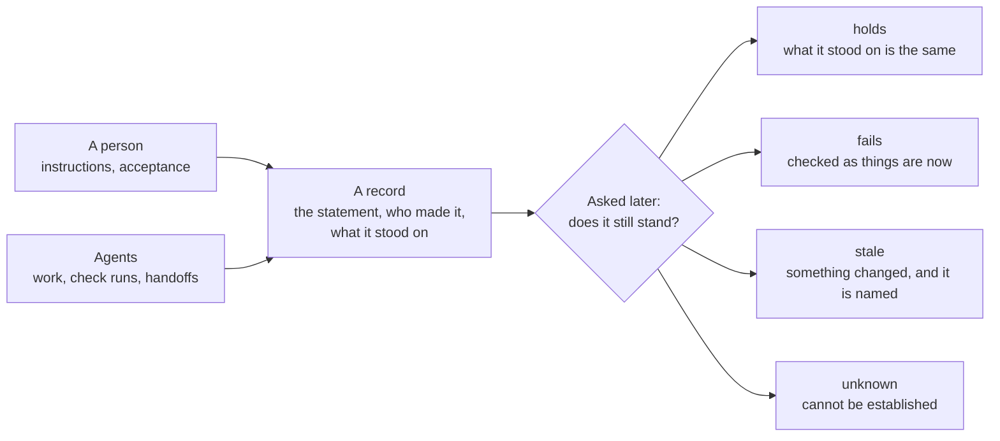

# ThesisAnalysisOS

**Every result an agent records is kept with what it stood on, so that later
the system can say whether it still holds, and why.**

[See a recorded run in the browser](https://justinben0131.github.io/ThesisAnalysisOS/),
with every claim read back against the code.

A result that carries only a date can be trusted by age or not at all. A
result that carries its basis can be asked. This repository is that one
comparison, applied to everything a research project relies on: a check that
passed, an instruction a person gave, a person's acceptance of a result, what
an agent is handed when it starts a session, and the numbers on this page.

It is a local, zero-dependency operating layer for research done with AI
agents. Tasks, instructions, checks and handoffs are plain files under one
directory, so the work survives the end of a session and a second agent can
pick it up. It runs on the Python standard library and never calls a network
or a model. Delete the directory to uninstall.

This is an independent research prototype, generalized from the operating
layer of a physics thesis analysis run with two AI agents. It is not
affiliated with any employer or product.



## See it in a minute

```bash
git clone https://github.com/JustinBen0131/ThesisAnalysisOS.git
cd ThesisAnalysisOS
./taos demo
```

The demo builds a throwaway copy of a small measurement (six pendulum swings,
a fit for g, a check) and runs real commands against it. Nothing of yours is
touched. Part of what it prints:

```text
$ taos why PEN-1
    holds    closure: codex moved it to done on 2026-11-21; the same instructions govern
    holds    check fit: passed 2026-11-21T22:26:19Z; nothing it tested has changed
    PEN-1 stands as recorded. No person has accepted it yet.

One swing is measured again, and data/swings.csv changes.
$ taos why PEN-1
    stale    check fit: analysis changed: data/swings.csv
    PEN-1 does not stand as recorded: stale.

Another task needs the same check on the same files. It is not run twice.
$ taos gate run --task PEN-2 --agent claude
    held  fit          not rerun: nothing it tested has changed since 2026-11-21T22:26:19Z

A second check reads figures/style.txt, but says it depends only on the analysis. It is marked
isolated, so it runs in an empty folder that holds only the files it declared.
$ taos gate run --task PEN-2 --agent claude
    FAIL  style        exit 2
    grep: figures/style.txt: No such file or directory
    isolated: it could read only analysis. A file it could not find is one it did not declare.
```

## The idea

The failures this system was built to stop have one shape: a record was
consulted without the conditions it was true under. A check passed, and the
files were edited afterwards. An instruction was given, and later replaced.
A reminder was shown, and the count of times shown was read as a count of
mistakes. Each record was true. Each was true of something that had changed.

So TAOS stores a statement together with who made it and what it stood on,
and answers one question about it later:

| Answer | Meaning |
|---|---|
| `holds` | what it stood on is the same |
| `fails` | it was checked on things as they are now, and did not pass |
| `stale` | something it stood on changed, and the answer names it |
| `unknown` | it cannot be established: never checked, not recorded, or a change nobody declared the effect of |

`unknown` is an answer. It is never rounded to true, to false or to zero.

Three rules follow. None of them depends on which models are in use.

1. **Validity is the basis, not the age.** A pass is good for the bytes it
   tested, for as long as they are those bytes. An hour-old pass on edited
   files is worth nothing; a month-old pass on unchanged files is still a pass.
2. **The original words outrank any summary of them.** An instruction is kept
   as it was said, with its date, scope and expiry, and is delivered in those
   words. A summary carries the hash of its original and goes stale with it.
3. **An observation has a kind and a source.** Shown is not violated.
   Recommended is not executed. Missing is not false. A check passing is not
   a person accepting the result.

**Why this matters more as agents do more.** A project run by agents piles up
earlier results faster than anyone can recheck them. Rerunning everything
does not scale, and trusting by age is wrong in both directions at once: in
the experiment below, every age limit either reran work that nothing had
touched or relied on work that something had. A result kept with its basis
was rerun exactly when an edit reached it, and was never relied on wrongly.

The idea is old, and `docs/METHOD.md` says where it comes from: build systems
and truth maintenance systems have kept results with their justifications for
decades. What is added here are the things research rests on that a build
system does not model: dated human instructions, and a person's acceptance of
one exact version.

## What is tested

Every claim in this repository is listed in `docs/CLAIMS.md` with the code
that implements it, the test that checks it, and its status. The short form:

| Claim | Evidence | Run it yourself |
|---|---|---|
| Earlier releases had 22 distinct cases of a record read without its conditions; each is now refused or reported | 22 of 22 fail at `071a348`, 5 of 22 fail at `89f36ce`, 22 of 22 pass here | `python3 evals/at_revision.py` |
| The tests check what they say they check | 20 protections removed one at a time; 20 of 20 removals are caught | `python3 evals/mutations.py` |
| Reusing a result by its basis never relies on a stale one, and reruns only what an edit reached | 60 edits, 360 results relied on: 60 executions and 0 wrong reuses, the same as an oracle; age limits gave 180 to 48 executions with 30 to 161 wrong reuses | `python3 evals/reuse_frontier.py` |
| A check that reads what it did not declare is reused wrongly in the open, and cannot pass in isolation | 150 wrong reuses in 360 in the open; isolated, 0 of 366 runs passed, so nothing was reused | same |
| The whole suite passes | 151 tests, Python 3.9 and 3.12, Linux and macOS | `./taos selftest` |
| This page says what the recorded runs say | every row of `docs/CLAIMS.md` and every number above, read back against the code as it is | `python3 evals/claims.py` |

**These numbers are records too.** Each run is stored in `evals/results/`
with a fingerprint of the code it measured. `python3 evals/claims.py` asks of
every claim what TAOS asks of any result, and answers `holds`, `stale`,
`fails` or `unknown`. Edit `taos_core/gates.py` and the reuse numbers are
`stale` until they are measured again. CI fails until then.

The isolation result was a prediction first. It was committed on its own
before the code existed, so the history shows the order (`docs/METHOD.md`,
"A seventh prediction").

## What it does not do

- **In the open, it trusts what a check declares.** A check that reads a
  folder it did not declare is reused when that folder changes. Marking the
  check `"isolated": true` makes it run with only its declared files present
  and a fixed environment, so it cannot be reused wrongly. On macOS the
  network and the rest of the workspace are closed to it too; elsewhere the
  record says they were open. That costs placing those files for each run,
  and a file outside the workspace can still be read by its absolute path.
- **With no domains declared, it does not see a file git ignores.** Name the
  file in a domain and it is part of what a check stood on.
- **It cannot see outside the workspace.** A check that depends on the
  network, the clock or the environment has to say so with `max_age_hours`.
- **Asking has a cost.** Every answer re-reads the files, and the time grows
  with the tree (measured in `docs/CLAIMS.md`). Reuse pays when a check costs
  more than a few milliseconds per file set, and does not pay for a trivial
  check on a very large tree.
- **The evidence is mechanical.** These tests show the mechanism does what it
  says. They do not show that research done with it comes out better. That
  needs a study this repository does not contain.

## Reading this repository

| If you have | Start with |
|---|---|
| one minute | `./taos demo` |
| five minutes | this page, then `docs/CLAIMS.md` |
| twenty minutes | `taos_core/basis.py` (the comparison, about 250 lines), `tests/test_counterexamples.py`, then `docs/METHOD.md` from "One error, one answer" |
| an agent with you | `docs/ARCHITECTURE.md`, "Reading this repository cold": where each idea lives, the commands that verify it, and what to keep true when changing it |

An agent asked to examine or change TAOS should not set it up first.
`AGENTS.md` says so in its first section.

## Use it for your own work

Make your own private copy from the template. This is meant to be a repo you
rewrite, not one you track.

```bash
gh repo create <you>/<your-os-repo> --private --clone --template JustinBen0131/ThesisAnalysisOS
cd <your-os-repo>
codex        # or: claude
```

On github.com the same thing is the **Use this template** button. `MANUAL.md`
has two other ways, for keeping the upstream or for working without GitHub.

Paste as the first message to the agent:

```
Read BOOTSTRAP.md in this repo and follow it exactly. Ask me the ten bootstrap questions in one message, then construct the OS from my answers. Do not touch anything outside this directory until I have answered.
```

Answer the questions. The agent validates, constructs, runs the doctor, and
starts your first task. Then, in your own terminal:

```bash
./taos panel on
```

**The split that matters:** this private repo holds the OS and your operating
state (`.taos/` is git-ignored, so your tasks never leave your disk). Your
actual work repos receive only a four-line block in `AGENTS.md`, a
`.taos-link.json`, and optionally the hook files. Nothing else crosses, so
nothing your colleagues review ever contains your agent bookkeeping. See
`policies/REPO_SPLIT.md`.

## What a day looks like

```bash
./taos status                # where everything stands, in ten lines
./taos why                   # what was recorded and no longer holds, and why
./taos brief --print         # what changed, what needs you, nothing else
./taos task list             # every task, hot ones first
```

Tell either agent "work on AZ-7". It runs `taos start` and is shown what
stands, which of your instructions govern the task in your own words, and
what was learned the last time. It works, runs the checks, and finishes with
evidence or a handoff the other agent can pick up. A task cannot be moved to
review or done unless its checks hold on the files as they are, by any route.
When you have looked at the result, `./taos task accept AZ-7` records that you
accepted that version; a later edit does not inherit it.

## The parts

| Part | What it does |
|---|---|
| `taos` | the whole command line, stdlib only |
| `taos_core/basis.py` | the one place a result is compared with what it stood on |
| `taos why`, `taos_core/standing.py` | every record a task rests on, read back against the present |
| `AGENTS.md`, `CLAUDE.md` | the contract both agents read, rendered for you at setup |
| `hooks/` | one guard for both agents: no secrets, no force pushes, no writes in the other agent's lane |
| `.taos/` | your state: tasks, claims, events, decisions, handoffs, check results |
| `kernels/` | distilled context with a fingerprint and an expiry |
| `atoms/` | corrections a machine can check, run by `taos doctor` |
| `policies/` | the rules, each under a page |
| `taos change`, `lesson`, `replay`, `bank`, `rule`, `anchor` | how you know the system is getting better (`docs/METHOD.md`) |
| `evals/` | the four evaluations above, each one command, and the runs they recorded |
| `examples/measurement/` | the small measurement the demo uses |
| `MANUAL.md` | the manual for the human |
| `docs/ARCHITECTURE.md` | the map for anyone, person or agent, reading the code |
| `docs/SPEC.md` | the binding spec for anyone changing the OS |

## The science layer

The parts above keep two agents from colliding. These keep the system honest
about itself. Each came from a measured failure; the measurements are in
`docs/METHOD.md`.

```bash
./taos change register ...   # say what a change will move, and a control that must not, before making it
./taos change score ...      # graded by someone who did not build it, from receipts or a named measurement
./taos lesson at reply ...   # your past corrections, printed at the moment they apply; that is an exposure
./taos lesson outcome ...    # whether the mistake was made again in that case; only this counts as a repeat
./taos replay --history h.jsonl --field gib --threshold 8 --threshold 16
                             # size a new limit on your own history; rows with no label are counted apart
./taos bank score answers.json   # replay past decisions; a reader counts only after passing controls
./taos rule governing plots --on 2026-03-02   # the instructions in force on a date, as their original words
./taos anchor resolve ...    # refused without a reference, a control and a prediction made beforehand
```

## Lineage

This is the generalized second version of an operating layer that ran a
two-agent physics thesis through 2026: hundreds of tasks, both agents in daily
use, every collision and every lost handoff paid for once. What survived is
here; what did not is in `docs/LINEAGE.md`.

## License

PolyForm Noncommercial 1.0.0, with additional permissions. In plain words:

- Use it, change it, share it, for yourself, for research, for study, and to
  organize your own work, including at your job. Free.
- Keep the copyright notice with every copy and every derivative.
- Do not sell it, sublicense it, host it as a service, or ship a product built
  on it. That needs a separate written license from the author.

Full text and the exact additional permissions are in `LICENSE`.
